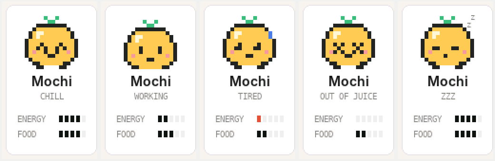
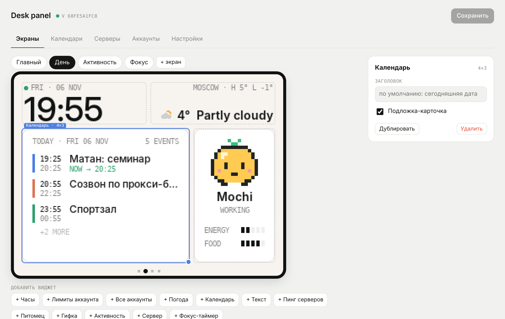
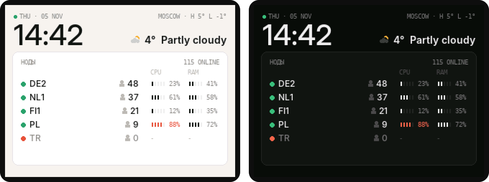

# cyd-ai-panel

Маленькая панелька на столе. Сначала делал её, чтобы видеть сколько лимитов Claude и Codex я уже спалил, потом понеслось - календарь, пинг нод, заметки, гифки и пиксельный питомец, который грустит когда лимиты кончаются. Всё собирается в веб-конструкторе и улетает на экран за пару секунд.

Железо - дешёвая CYD (ESP32 с экраном 2.8").


## Что умеет

- лимиты Claude и Codex - сессия 5ч и неделя, когда сброс. черточка под полоской - где ты должен быть при ровном темпе
- до 6 аккаунтов, можно все в табличку или каждый отдельной карточкой
- календарь на сегодня и завтра из Google, Яндекса, iCloud или любой ics-ссылки
- пинг серверов - ping, tcp-порт или http, с мини-графиком
- ноды Remnawave - статус, онлайн, CPU и RAM прямо из API панели, только чтение
- текст из конструктора - заметка, напоминалка, что угодно
- свои гифки и картинки, сервер сам ужимает их под блок
- питомец Mochi - настроение зависит от лимитов, ночью спит
- часы, погода, активность за сутки, нагрузка сервера, помидор-таймер
- днём светлая тема, ночью тёмная и тусклая подсветка



## Конструктор

Открываешь в браузере с телефона или ноута, таскаешь блоки по сетке 6×4, тянешь за уголок чтобы поменять размер. Превью справа рисуется тем же кодом что и на панели, так что как в редакторе - так и на экране.



## Как это работает

```
сервер (не в рф)                              панель дома
  hub.py
    -> лимиты anthropic / openai
    -> календари, погода, пинг
    -> хранит раскладку экранов
    /panel.json  <------------------------  раз в 5 сек спрашивает "что-то поменялось?"
    /  (конструктор)  <---  ты с телефона
```

Хаб живёт на любом линукс сервере. Логинишься там один раз в Claude Code и Codex, дальше он сам обновляет токены. Панель ходит только на твой сервер. Комп и впн не нужны.

Лимиты берутся оттуда же, откуда их показывают сами Claude Code и Codex. Это неофициальные эндпоинты, однажды могут сломаться.

## Что нужно

- CYD aka ESP32-2432S028 (на али ~1000р)
- кабель USB-A -> C или micro-USB. C-C у многих CYD не даёт питания
- любой линукс сервер не в рф
- мак или комп с PlatformIO чтобы прошить

## Сервер

Всё под root. Ставится в `/opt/ai-panel` и ничего другого на сервере не трогает.

1. Закинуть репу и поставить

```
git clone https://github.com/knefrus/cyd-ai-panel
bash cyd-ai-panel/server/install.sh
```

Скрипт поставит зависимости, соберёт рендерер для превью, спросит пароль для конструктора, поднимет службу и в конце напишет две ссылки - конструктор и `DATA_URL` для панели.

Панель ходит по ключу из `DATA_URL`, а конструктор пускает только по паролю. Сменить пароль - `python3 /opt/ai-panel/server/hub.py --set-password`, все старые входы при этом слетят.

2. Залогиниться в Claude

```
curl -fsSL https://claude.ai/install.sh | bash
~/.local/bin/claude
```

Вход через подписку, открыть ссылку, вставить код, потом `/exit`.

3. Залогиниться в Codex

```
A=$(uname -m); [ "$A" = "aarch64" ] && T=aarch64 || T=x86_64
cd /tmp && curl -fsSL -o codex.tgz "https://github.com/openai/codex/releases/latest/download/codex-$T-unknown-linux-musl.tar.gz" && tar xzf codex.tgz && install -m755 "codex-$T-unknown-linux-musl" /usr/local/bin/codex && cd ~
codex login --device-auth
```

Если пишет что вход по коду выключен - включить в настройках ChatGPT в безопасности.

Через минуту лимиты появятся во вкладке «Аккаунты» в конструкторе. Если снаружи ничего не открывается - открыть порт 8787 в панели хостера.

Обновиться потом - `cd cyd-ai-panel && git pull && bash server/install.sh`. Ключ и настройки сохранятся.

Логи: `journalctl -u ai-panel -f`

## Прошивка

1. Поставить PlatformIO

```
brew install platformio
```

2. Скопировать конфиг и вписать wifi (только 2.4 ГГц) и `DATA_URL` с сервера

```
cp src/config.example.h src/config.h
```

`config.h` в гит не попадает.

3. Прошить кабелем

```
pio run -e cyd -t upload
```

Если висит на `Connecting...` - зажать BOOT на плате.

Какую сборку брать:

- `cyd` - обычная плата
- `cyd_inv` - если цвета инвертированы
- `cyd_st7789` - если белый экран с помехами (у меня такая). если цвета вывернуты (фон тёмный, точка у Claude голубая) - поменяй в ней `PANEL_INVERT` на `1`

Дальше можно шить по воздуху: `pio run -e cyd_ota -t upload` или `cyd_st7789_ota`. Всё остальное - экраны, тему, яркость, город - теперь можно менять в конструкторе, перепрошивать не надо.

## Несколько аккаунтов

Каждый аккаунт логинится в свою папку на сервере:

```
CLAUDE_CONFIG_DIR=~/.claude-2 ~/.local/bin/claude
CODEX_HOME=~/.codex-2 codex login --device-auth
```

Потом во вкладке «Аккаунты» добавить его с той же папкой. Влезает до 6 штук.

## Ноды Remnawave



Хаб читает `GET /api/nodes` панели токеном только на чтение. Токен и ключ лежат в `/opt/ai-panel/.env` (права 600), в конструктор и логи не попадают.

```
nano /opt/ai-panel/.env
```

- `REMNA_URL` - адрес панели. если хаб стоит на том же сервере - `http://127.0.0.1:3000`, нужные заголовки он добавит сам
- `REMNA_TOKEN` - api-токен Remnawave, достаточно Nodes: Read и System: Read
- `REMNA_API_KEY` и `REMNA_KEY_HEADER` - если панель закрыта caddy-security по ключу
- `REMNA_*_FIELD` - какие поля брать. сверить по тому, что отдаёт панель:

```
python3 /opt/ai-panel/server/hub.py --remna-dump
systemctl restart ai-panel
```

Для Remnawave 2.7 рабочие поля такие: CPU - `system.stats.loadAvg.0/system.info.cpus` (это загрузка по load average на ядро, не точный процент), RAM - `system.stats.memoryUsed/system.info.memoryTotal`. Дамп прячет адреса, uuid и всё похожее на ключи. Если панель не ответила - на экране остаются последние данные с пометкой `STALE`.

## Календари

Во вкладке «Календари» вставить ics-ссылку и нажать «Проверить».

- Google - настройки календаря -> «Секретный адрес в формате iCal»
- Яндекс - настройки календаря -> «Экспорт» -> ссылка
- iCloud - поделиться -> «Публичный календарь», webcal:// тоже подходит

Повторы, исключения и переносы событий понимает.

## Управление

- свайп влево / вправо или тап у края - соседний экран
- тап по таймеру - старт / пауза, зажать - сброс
- зажать часы - сменить тему до следующего изменения в конструкторе
- зажать в любом другом месте - домой
- кнопка BOOT - следующий экран

## Если что-то не так

- `STALE` на карточке - сервер не достучался до апи, цифры последние известные. смотреть логи
- `Waiting for data` - панель не видит сервер, проверить `DATA_URL` и что порт открыт
- гифка пишет `Loading` - панель ещё качает её, подожди пару секунд
- тапы перепутаны - `TOUCH_OFFSET_ROTATION 2` в конфиге. если перевёрнута только вертикаль или горизонталь - `TOUCH_FLIP_Y 1` или `TOUCH_FLIP_X 1`
- экран вверх ногами - `SCREEN_ROTATION 3`

## Внутри

- `src/ui.cpp` - все виджеты, рисуются через тонкий интерфейс `Gfx`, поэтому тот же код работает и на ESP32, и в рендерере на сервере
- `src/json.cpp` - крошечный json-парсер, общий для панели и рендерера
- `server/hub.py` - хаб и конструктор, только stdlib + Pillow для гифок
- `server/ics.py` - разбор календарей
- `tools/render.cpp` - рисует экран в картинку без платы, все скрины выше оттуда
- шрифт Inter со сглаживанием и кириллицей, генерится `tools/make_fonts.py`
- гифки хранятся на панели в LittleFS, кадр рисуется полосами, весь в память не влезает

```
g++ -std=c++17 -Isrc tools/render.cpp src/ui.cpp src/model.cpp src/json.cpp -o render
./render tools/demo.json out.bmp --screen 1
```

Вдохновлялся [desk-display](https://github.com/rhys-thomas-QA/desk-display) и [codex-desk-display](https://github.com/Safken/codex-desk-display).

## Лицензия

MIT. Шрифт Inter - SIL OFL.
