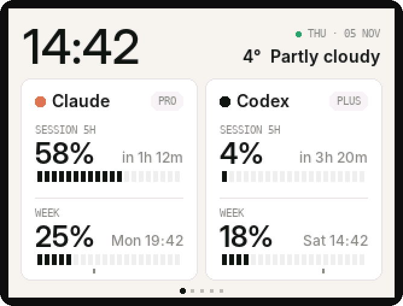
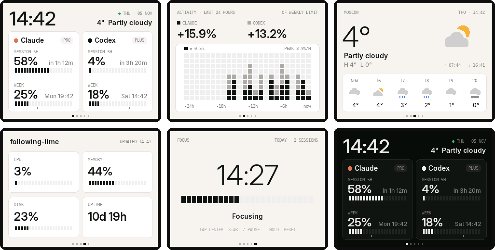
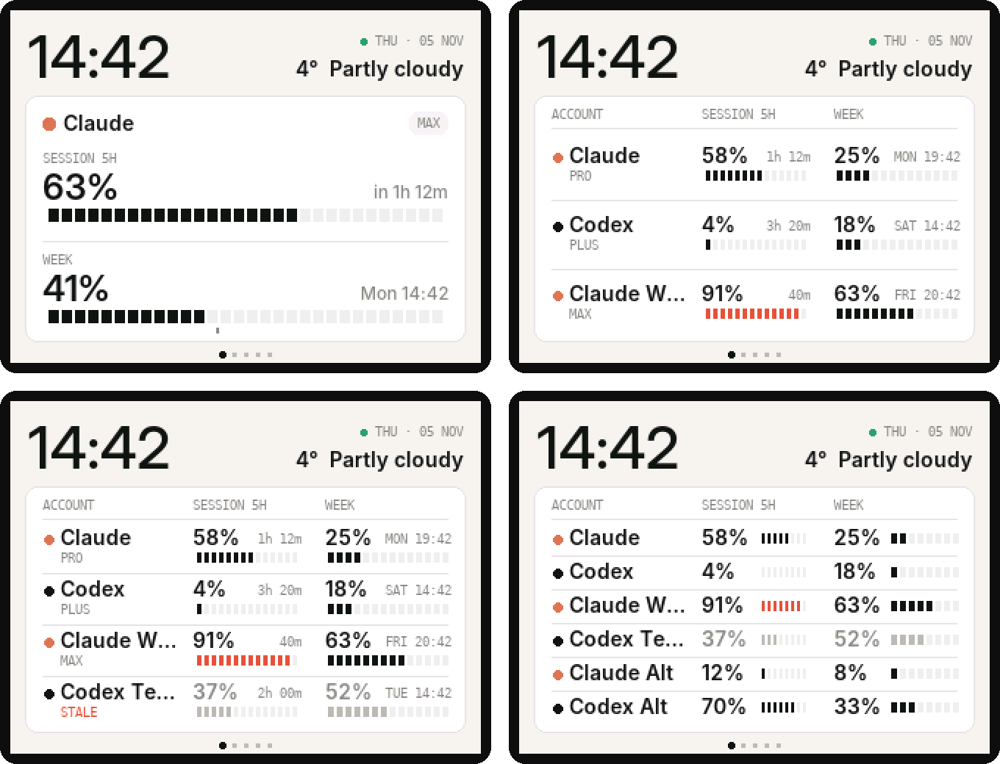

# cyd-ai-panel

Маленькая панелька на столе, которая показывает сколько лимитов Claude и Codex я уже спалил. Сделал на дешёвой CYD (ESP32 с экраном 2.8") за пару вечеров, потому что надоело лезть в `/usage` каждые полчаса.



Что умеет:

- лимиты сессии (5ч) и недели для Claude и Codex, когда сброс
- черточка под недельной полоской - где ты должен быть при ровном темпе. блоки правее черты - тратишь быстрее чем надо
- от 1 до 6 аккаунтов, от трёх сама сжимается в табличку
- график активности за сутки, погода, нагрузка сервера и помидор-таймер
- днем светлая тема, ночью тёмная и тусклая подсветка



## Как это работает

```
сервер (не в рф)                       панель дома
  feeder.py раз в минуту:
    -> anthropic: сколько лимита
    -> openai: сколько лимита
    отдаёт /panel.json   <-----------  забирает раз в минуту по wifi
```

Скрипт живёт на любом линукс сервере. Логинишься там один раз в Claude Code и Codex, дальше он сам обновляет токены. Панель ходит только на твой сервер, в сами Claude и ChatGPT она не лезет. Комп и впн для этого не нужны.

Лимиты берутся из тех же мест, откуда их показывают сами Claude Code и Codex. Это неофициальные эндпоинты, так что однажды могут сломаться.

## Что нужно

- CYD aka ESP32-2432S028 (на али ~1000р)
- кабель USB-A -> C или micro-USB. C-C у многих CYD не даёт питания
- любой линукс сервер не в рф
- мак или комп с PlatformIO чтобы прошить

## Сервер

Все команды под root. Бот, синк и прочее что уже крутится на сервере это не трогает - всё лежит в `/opt/ai-panel`.

1. Закинуть скрипт

```
mkdir -p /opt/ai-panel
```

и залить туда `feeder/feeder.py` (через sftp или `scp`).

2. Залогиниться в Claude

```
curl -fsSL https://claude.ai/install.sh | bash
~/.local/bin/claude
```

Выбрать вход через подписку, открыть ссылку, вставить код. Потом `/exit`.

3. Залогиниться в Codex

```
A=$(uname -m); [ "$A" = "aarch64" ] && T=aarch64 || T=x86_64
cd /tmp && curl -fsSL -o codex.tgz "https://github.com/openai/codex/releases/latest/download/codex-$T-unknown-linux-musl.tar.gz" && tar xzf codex.tgz && install -m755 "codex-$T-unknown-linux-musl" /usr/local/bin/codex && cd ~
codex login --device-auth
```

Если пишет что вход по коду выключен - включить в настройках ChatGPT в безопасности.

4. Проверить

```
apt install -y python3-psutil
python3 /opt/ai-panel/feeder.py --dry
```

Должны быть `Claude` и `Codex` с цифрами.

5. Запустить службой

```
KEY=$(openssl rand -hex 8)
cat > /etc/systemd/system/ai-panel.service <<EOF
[Unit]
Description=AI panel feeder
After=network-online.target

[Service]
User=root
ExecStart=/usr/bin/python3 /opt/ai-panel/feeder.py --serve 8787 --key $KEY
Restart=always
RestartSec=10
Nice=10
MemoryMax=100M

[Install]
WantedBy=multi-user.target
EOF
systemctl daemon-reload && systemctl enable --now ai-panel
echo "http://$(curl -s -4 ifconfig.me):8787/panel.json?key=$KEY"
```

Последняя строка - это адрес для панели. Если снаружи не открывается - открыть порт 8787 в панели хостера.

Логи: `journalctl -u ai-panel -f`

## Прошивка

1. Поставить PlatformIO

```
brew install platformio
```

2. Скопировать конфиг и вписать свои данные

```
cp src/config.example.h src/config.h
```

В `config.h` - wifi (только 2.4 ГГц) и `DATA_URL` с сервера. Этот файл в гит не попадает.

3. Прошить

```
pio run -e cyd -t upload
```

Если висит на `Connecting...` - зажать BOOT на плате.

Какую сборку брать:

- `cyd` - обычная плата
- `cyd_inv` - если цвета инвертированы
- `cyd_st7789` - если белый экран с помехами (у меня такая)

Дальше можно шить по воздуху: `pio run -e cyd_ota -t upload` или `cyd_st7789_ota`.

## Несколько аккаунтов

Каждый аккаунт логинится в свою папку:

```
CLAUDE_CONFIG_DIR=~/.claude-work ~/.local/bin/claude
CODEX_HOME=~/.codex-work codex login --device-auth
```

Потом создать `/opt/ai-panel/accounts.json` по примеру `feeder/accounts.example.json`:

```json
[
  {"name": "Claude", "kind": "claude", "dir": "~/.claude"},
  {"name": "Codex", "kind": "codex", "dir": "~/.codex"},
  {"name": "Claude Work", "kind": "claude", "dir": "~/.claude-work", "color": "#5B8AEA"}
]
```

и добавить `--accounts /opt/ai-panel/accounts.json` в `ExecStart` в `/etc/systemd/system/ai-panel.service`, потом `systemctl daemon-reload && systemctl restart ai-panel`.

Влезает до 6 штук:



## Без сервера

Можно гонять скрипт прямо на компе, тогда он сам шлёт данные на панель по домашней сети. Минус - на компе Claude и ChatGPT должны открываться.

```
python feeder/feeder.py --panel ai-panel.local
```

На винде для автозапуска есть `feeder/install_windows.bat`. `DATA_URL` в конфиге тогда оставить пустым.

## Управление

- тап справа / слева - следующий / предыдущий экран
- тап по центру на главном - сменить тему
- тап по центру на таймере - старт / пауза
- зажать - сброс таймера или домой
- кнопка BOOT - следующий экран

Через 2 минуты без касаний возвращается на главный.

## Если что-то не так

- `STALE` на карточке - сервер не достучался до апи, цифры последние известные. смотреть логи
- `Waiting for data` - панель не видит сервер, проверить `DATA_URL` и что порт открыт
- тапы перепутаны - `TOUCH_OFFSET_ROTATION 2` в конфиге
- экран вверх ногами - `SCREEN_ROTATION 3`

## Внутри

- LovyanGFX, кадр рисуется двумя полосами 320x120, целиком в память не влезает
- шрифты Inter, сглаженные, генерятся `tools/make_fonts.py`
- `tools/sim` рендерит экраны в картинки без платы, все скрины выше оттуда

```
g++ -std=c++17 -Isrc tools/sim/sim.cpp src/ui.cpp -o sim && ./sim .
```

Вдохновлялся [desk-display](https://github.com/rhys-thomas-QA/desk-display) и [codex-desk-display](https://github.com/Safken/codex-desk-display).

## Лицензия

MIT. Шрифт Inter - SIL OFL.
